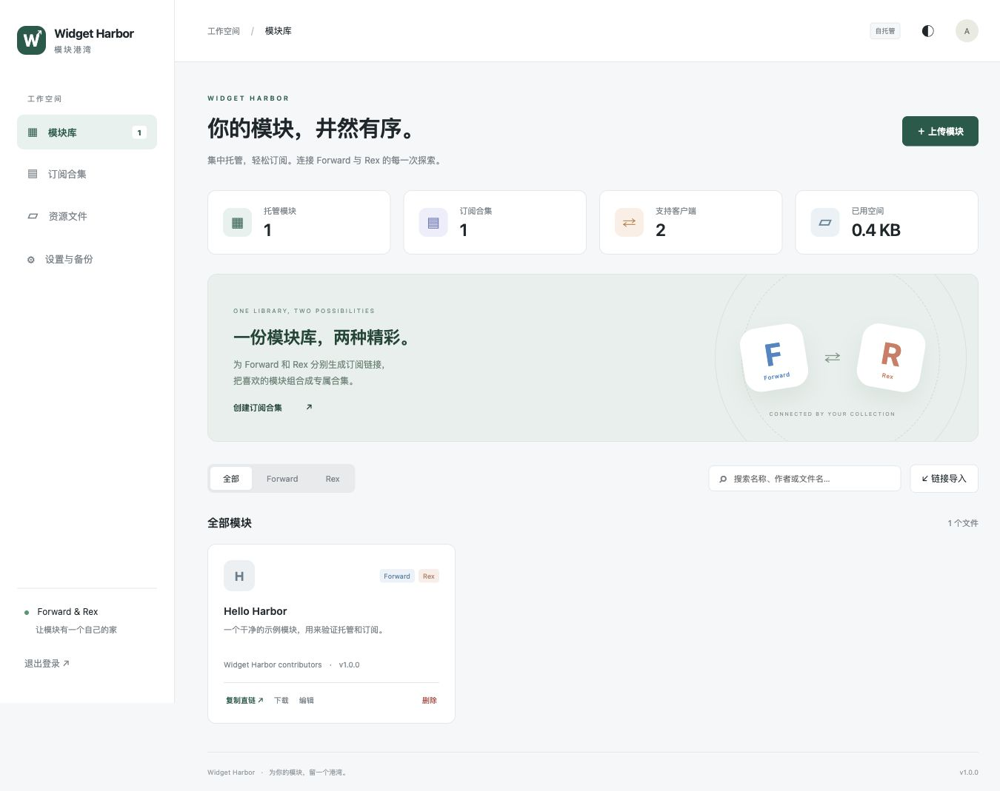

# Widget Harbor · 模块港湾

一个面向 **Forward / Rex** 的轻量、自托管模块管理平台。用 Docker 启动，集中管理模块、资源文件和订阅合集。

- 上传 `.js` 模块，解析 `WidgetMetadata`，在线编辑或替换文件。
- 导入远程模块及 `.fwd` / `.rex` 订阅，将引用的模块下载到本站；手动刷新远程文件，合集可每天自动刷新。
- 同一合集生成 **Forward `.fwd`** 和 **Rex `.rex`** 两种订阅链接，按平台标记过滤模块。
- 支持 `FWENC1` / `REXENC` 加密文件，保存并分发原始字节；不解密、不执行上传代码。
- 任意资源文件托管，提供访问和下载链接；HTML/SVG 等主动内容强制下载。
- 卡片 / 按来源分组的列表视图、排序、全选、批量编辑与删除。
- 管理员头像与密码管理、本地合集图标、移动端布局、明暗主题、JSON 备份恢复。
- Python 标准库 + SQLite + 原生前端，无 npm / pip 运行依赖；支持 amd64 / arm64 构建。

> 当前版本为**单管理员、公开链接分发**模式。文件与订阅链接无需登录，请不要上传密钥或私人资料。双平台支持指订阅格式和平台分类；不会把某一客户端专用的脚本 API 自动转换为另一种。请用实际客户端验证模块功能。



## 快速开始

当前稳定版 **v1.4.1**：[下载发行包](https://github.com/halestats/widget-harbor/releases/latest) · [Linux 安装](docs/INSTALL.md) · [升级已有部署](docs/UPGRADE-1.4.md)。

需要 Docker Engine 和 Docker Compose v2 或更新版本。下载本仓库后，在项目根目录执行：

```bash
# 方式一：本机有 Python 3 时，自动创建随机密码（不覆盖现有 .env）
python3 scripts/init_env.py

# 方式二：没有 Python 时，复制后手动编辑；二选一即可
# cp .env.example .env
```

打开 `.env`，记下 `ADMIN_PASSWORD`。如果使用方式二，**必须替换示例密码**，至少 12 个字符。

```bash
docker compose up -d --build
docker compose ps
```

浏览器访问 `http://localhost:8765`，用 `.env` 中的管理员密码登录。

**NAS / 另一台电脑 / 手机访问：**把 `.env` 中 `BIND_ADDRESS` 改为 NAS 的局域网 IP（或 `0.0.0.0`），将 `SITE_URL` 改为 `http://NAS的局域网IP:8765`，再执行 `docker compose up -d`。手机与 NAS 在同一网络即可访问。`localhost` 在手机上指手机自身，不能用来访问 NAS。

**公网部署：**使用 HTTPS 反向代理，把 `SITE_URL` 设为实际域名，例如 `https://widgets.example.com`。参见 [部署指南](docs/DEPLOYMENT.md)。

## 第一次使用

1. **模块库 → 上传模块**：选择自己的 `.js`，或上传 `examples/hello-widget.js` 验证格式识别。
2. 确认兼容平台：Forward、Rex 或双平台。平台标签由管理员确认，不进行脚本运行测试。
3. **订阅合集 → 创建合集**：填写名称、英文链接标识，勾选模块后保存。
4. Forward：复制合集卡片上的 `.fwd` 链接，在客户端模块订阅界面粘贴。
5. Rex：复制 `.rex` 链接，或在已安装 Rex 的设备上点击 **+ Rex**。
6. 有远程来源的文件可点击 **刷新**；更新保留本站文件 ID 和直链，失败保留旧内容。
7. **设置与备份 → 导出完整备份**，定期保存到其他设备。

`examples/hello-widget.js` 是格式验证样例，不提供影片源或业务功能。`examples/collection.fwd` 和 `.rex` 使用占位 URL，导入前应替换为真实公开直链。

## 配置

| 变量 | 默认值 | 用途 |
| --- | --- | --- |
| `ADMIN_PASSWORD` | 必填 | 初始管理员密码，至少 12 个字符；日常修改请使用设置中的密码管理 |
| `SITE_URL` | `http://localhost:8765` | 客户端可访问的站点根地址，不含路径；生成链接和校验浏览器来源 |
| `ALLOWED_ORIGINS` | 空 | 额外允许的管理入口，完整协议、主机和端口，多个用英文逗号分隔 |
| `BIND_ADDRESS` | `127.0.0.1` | Docker 绑定的宿主机地址 |
| `HOST_PORT` | `8765` | 宿主机端口 |
| `DATA_DIR` | `/data` | 容器内数据库位置，通常不修改 |

默认使用 Docker 命名卷持久化，源码目录不包含数据库。容器以 UID/GID `10001:10001` 非 root 用户运行。

## 文档导航

- [Linux / Docker 安装](docs/INSTALL.md)
- [Linux 部署](docs/LINUX.md)
- [Docker / NAS / HTTPS / 更新与备份](docs/DEPLOYMENT.md)
- [GitHub 发布、Actions 和 GHCR 镜像](docs/GITHUB.md)
- [接口与订阅格式](docs/API.md)
- [架构、限制及兼容范围](docs/ARCHITECTURE.md)
- [测试与实机验收](docs/TESTING.md)
- [来源与许可说明](THIRD_PARTY_NOTICES.md)
- [贡献指南](CONTRIBUTING.md) · [安全政策](SECURITY.md) · [更新日志](CHANGELOG.md)

## 项目结构

```text
hub/                      后端、存储、元数据解析和远程获取
static/                   中文管理界面
examples/                 模块和双格式订阅示例
scripts/                  初始化、备份和恢复工具
tests/                    API / 存储 / 网络边界测试
docs/                     部署、API、发布和验证文档
.github/                  CI、镜像发布工作流、问题模板
Dockerfile / docker-compose.yml 容器镜像与启动配置
.env.example              配置模板，不含真实密码
```

## 本地开发

Python 3.11+（Docker 使用 3.13），无需安装依赖：

```bash
python3 scripts/init_env.py
# 按 .env 设置环境变量；本地默认容器数据目录 /data 不适用，使用开发启动器：
python3 scripts/dev.py
```

```bash
python3 -m unittest discover -s tests -v
node --check static/app.js
node tests/test_ui.cjs       # 前端逻辑回归，需要 Node.js
```

## 致谢与许可证

本项目根据 [Rex-Widgets-Hub](https://github.com/MakkaPakka518/Rex-Widgets-Hub)、[Widgets-Disk](https://github.com/MakkaPakka518/Widgets-Disk) 和 [forward-widget-hub](https://github.com/InchStudio/forward-widget-hub) 的公开功能和格式进行独立实现。没有复制其源码、截图或品牌素材；原项目的用户、管理令牌和数据库不能直接迁移。可通过公开订阅和文件直链导入。

本仓库原创代码使用 [MIT License](LICENSE)。第三方模块与资源仍适用各自的许可；详见 [THIRD_PARTY_NOTICES.md](THIRD_PARTY_NOTICES.md)。

## 图片、分类与排序

合集图标和文件夹封面独立存放在数据目录的 `images/` 中，远程图片会缓存。资源文件支持命名文件夹、封面和批量移动；删除分类保留文件。模块库、合集和资源均支持服务器持久化的自定义排序。

## 版本与同步规则

v1.4.1 已经包含此前所有功能。填写远程订阅来源并保存后，刷新会同步上游名称、描述、图标和成员，合集链接标识保持不变；未提供的字段保留本地值。自建合集刷新选中的远程模块，保留本地上传内容。每天刷新是距上次尝试满 24 小时后执行，容器需持续运行。

详情见 [更新日志](CHANGELOG.md) 与 [升级及刷新规则](docs/UPGRADE-1.4.md)。
