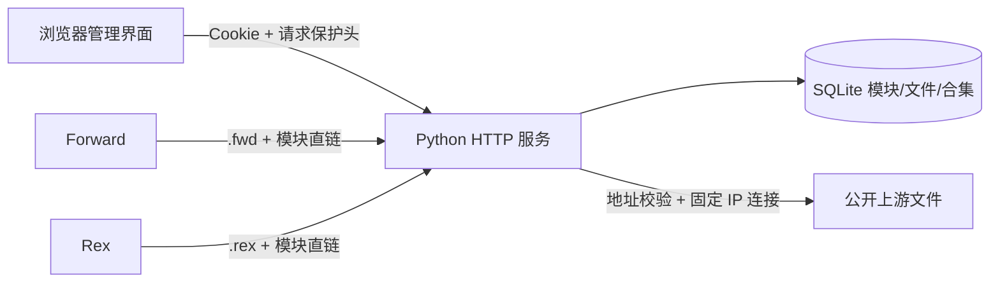

# 架构与边界

## 设计

- 单进程、多线程，最多 24 个活动请求；适合个人和小型自托管场景。公网放在 HTTPS 反向代理后，并按负载配置代理限流。
- 一个 SQLite 数据库存储文件 BLOB、元数据和合集关系。外键级联清理，备份和恢复具有事务一致性。
- 模块脚本只进行惰性字符串字段解析，不使用 eval、JavaScript 运行时或 VM。计算表达式不会求值，解析不到的字段可在界面填写。
- 每个文件拥有平台生成的随机 ID 和独立 widget_id。前者用于稳定直链，后者保留脚本标识。
- 请求认证使用随机会话，服务端仅保存会话摘要；Cookie 设置 HttpOnly/SameSite=Strict。HTTPS SITE_URL 下设置 Secure。
- 密码以 scrypt 派生值驻留进程；原始配置由 Docker 环境变量提供，不保存进数据库或备份。建议部署机限制 Docker 管理权限。
- 登录全局最多 20 次失败/10 分钟，不信任可伪造的 X-Forwarded-For；共享代理下此限制可能影响所有管理员。
- URL 获取限制公开 HTTP/HTTPS（支持 1–65535 端口），每次跳转都校验 DNS 结果，再连接已校验 IP，保留 TLS SNI 和证书验证。禁止私网、回环、链路本地及保留地址，不读取系统代理。
- 单文件 5 MiB，单次远程合集 50 文件/30 MiB，单个下载 40 秒预算（系统 DNS 解析时间由系统控制），最多 4 次重定向。导入阶段下载完毕再统一提交，任一模块失败则该合集不落库。
- 资源使用隔离 CSP；HTML/SVG/XML 强制下载。页面动态内容统一转义，管理端无外部脚本依赖。

## 兼容范围

| 原项目能力 | 本平台情况 |
| --- | --- |
| Rex JS 元数据、合集订阅、Rex 唤起 | 支持对应公开格式 |
| Widgets-Disk 文件访问/下载 | 支持相同用途；路径增加 ID，避免重名覆盖 |
| Forward JS / .fwd 依赖转存 | 支持，另增加 .rex 输出及平台过滤 |
| FWENC1 | 原样保存和下载，不解密 |
| 订阅者密码、用户配额、匿名上传令牌 | 当前不实现，采用单管理员 |
| 原项目 KV/D1/SQLite 数据库备份 | 不直接兼容，通过订阅/直链导入 |
| 自动定时同步整个上游合集 | 当前不实现；已导入文件可单独手动刷新 |
| 平台特有 JS API 自动转换 | 不提供，请分别验证客户端 |
| 原项目 UI/品牌素材 | 未复制，采用独立界面 |

## 已知限制

- 面向小规模部署；所有文件保存在 SQLite，JSON 备份较大时占用内存，推荐数据库备份 API。
- 不提供多用户、访问统计、模块版本历史、账号密码管理页面或私密订阅令牌。
- 订阅和文件公开可读。随机 ID 不能作为访问控制；资源公开后应按可分享内容管理。
- 更改模块信息不会改写源码中的 WidgetMetadata；内容更新后重新提取字段，可能覆盖之前手动填写的信息。
- 重复导入创建新模块，不根据 widget_id 自动覆盖。合集若加入相同脚本的多个副本，客户端可能根据 widget_id 去重，建议自行删除重复项。
- 所有接口使用 no-store，避免客户端获取过期内容；大流量部署需自行规划缓存策略。
- 这是独立实现，不隶属于 Forward、Rex 或三个参考项目。

## 合集同步

`hub/sync.py` 在进程内每分钟检查数据库中的每日刷新计划；与手动导入/刷新共享锁。下载在事务外完成，提交时核对成员、来源和模块快照，使用单个事务提交；有冲突则保留现有数据。时间和来源存于 collection_sync，JSON 与 SQLite 备份均可保存。

## 图库与目录

`hub/catalog.py` 管理摘要寻址图片、图片来源缓存、一级资源分类和服务器持久化排序。图库不占用普通资源记录；旧合集图标保留资源直链但从目录列表隐藏。远程图片沿用 network.fetch 的地址、重定向和超时限制，下载失败保留旧缓存，并限制重试频率。SQLite 是图片与目录的备份权威来源，images/ 是可重建缓存。当前不自动清理历史图片。
